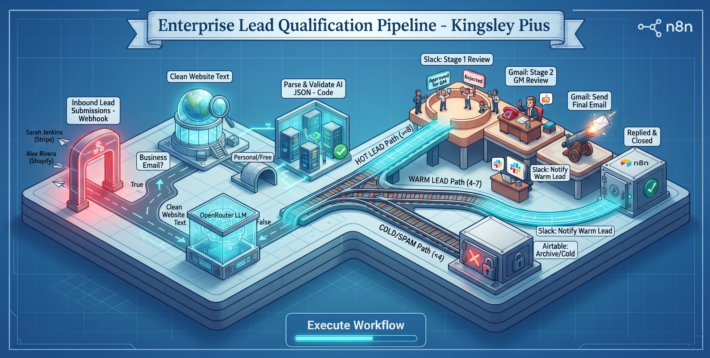
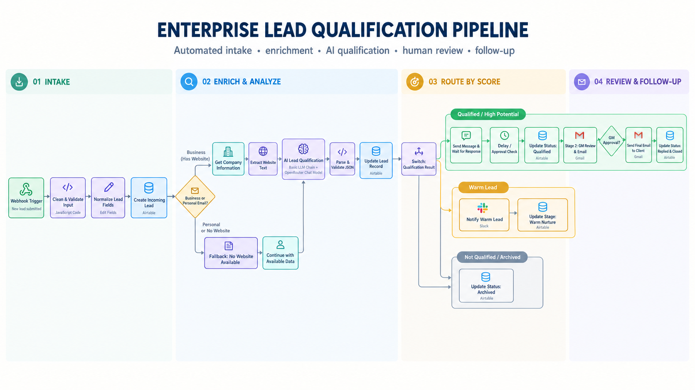
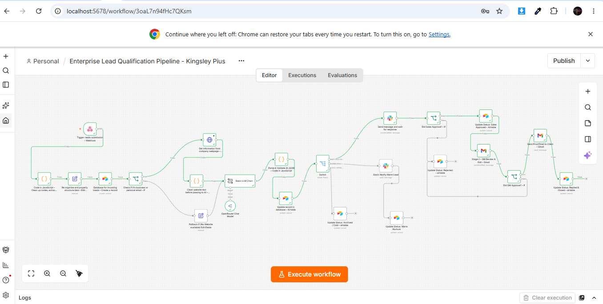

ENTERPRISE B2B LEAD QUALIFICATION & MULTI-TIER HITL PIPELINE (n8n + AI)
=======================================================================

Author: Kingsley Pius
Tech Stack: n8n (Self-Hosted via Docker), OpenRouter LLM, JavaScript (ES6), Airtable CRM, Slack Interactive Forms, Gmail HITL Approval, HTML5/REST Webhook

-----------------------------------------------------------------------
1. PROJECT OVERVIEW
-----------------------------------------------------------------------
An automated, state-machine Revenue Operations (RevOps) pipeline built in n8n that ingests inbound B2B leads via a custom webhook form, enriches business domains through live website scraping, qualifies buyer intent using an LLM with strict JSON schema validation, and routes leads across three dynamic tiers (Hot, Warm, and Cold/Spam).

High-intent enterprise leads (Score >= 8) trigger a 2-Stage Human-in-the-Loop (HITL) approval sequence—allowing Sales teams (via Slack) and the General Manager (via Gmail) to review, edit, or reject AI-drafted outreach before final dispatch to the client.

-----------------------------------------------------------------------
2. SYSTEM ARCHITECTURE & VISUAL ASSETS
-----------------------------------------------------------------------
- Architectural Diagram: architecture-diagram.jpg
- Workflow Design Blueprint: workflow-design.png
- Production n8n Canvas Screenshot: n8n-canvas.png

-----------------------------------------------------------------------
3. CORE ENGINEERING & WORKFLOW STAGES
-----------------------------------------------------------------------

STAGE 1: Webhook Ingestion, Data Sanitization & Domain Extraction
- Endpoint: POST /inbound-lead
- Normalizes raw payload fields (name, email, company, website, message) and extracts the email domain via JavaScript to classify leads as Business vs. Free/Personal (gmail.com, yahoo.com, etc.).
- Immediately logs the initial lead record into Airtable CRM with status "New" to guarantee zero data loss prior to downstream API calls.

STAGE 2: Conditional Web Scraping & HTML Sanitization
- Business Emails (True Branch): Executes an HTTP request to scrape the prospect's company website and runs a custom JavaScript regex sanitizer to strip script, style, and HTML tags down to clean context tokens.
- Free/Personal Emails (False Branch): Bypasses the scraper to conserve compute and prevent invalid URL exceptions, routing cleanly via a fallback branch.

STAGE 3: Calibrated AI Lead Scoring & Fault-Tolerant JSON Parsing
- LLM Integration (OpenRouter): Evaluates company context and inquiry message against a calibrated B2B scoring rubric (8-10 Hot, 4-7 Warm, 1-3 Cold/Spam) with Sampling Temperature set to 0 for deterministic classification.
- Branch-Safe Validation: Uses a JavaScript validator and .isExecuted guard expressions to parse the AI output into structured fields (qualification_score, buyer_intent, ai_summary, pain_points, draft_reply) and updates the Airtable record.

STAGE 4: Multi-Tier Routing (Switch Node) & Stateful Lifecycle Tracking
- HOT LEADS (Score >= 8) — 2-Tier Human-in-the-Loop (HITL):
  1. Stage 1 (Sales Review in Slack): Uses "Send and Wait for Response" to present a custom Slack form where reps can approve, reject, or overwrite the AI's email draft. Updates Airtable to "Pending GM Approval".
  2. Stage 2 (GM Final Sign-Off in Gmail): Sends an HTML executive briefing to the General Manager. Uses JavaScript fallback evaluation so if the GM approves without edits, the Sales Team's curated draft is automatically preserved and dispatched to the client. Updates Airtable to "Replied & Closed".

- WARM LEADS (Score 4-7) — Automated Sales Nurture:
  Dispatches a formatted alert to #sales-leads in Slack and updates Airtable status to "Warm - Nurture".

- COLD / SPAM LEADS (Score <= 3) — Silent Archive:
  Suppresses team notifications to eliminate alert fatigue and updates Airtable status to "Archived / Cold".

-----------------------------------------------------------------------
4. HOW TO TEST THIS PROJECT LOCALLY
-----------------------------------------------------------------------
1. Import the Workflow:
   - Open your n8n instance (http://localhost:5678) and import workflow.json.
   - Configure your Airtable, OpenRouter, Slack, and Gmail credentials.

2. Launch the Interactive Frontend Form:
   - Open index.html in any browser.
   - Use the 1-Click Preset Buttons (Fill Hot Lead, Fill Warm Lead, Fill Cold/Spam) to send real-time POST payloads directly to the n8n webhook.
